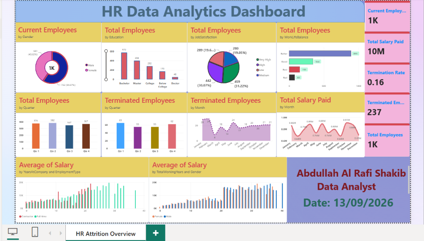

# HR Attrition Dashboard

Power BI dashboard analyzing employee attrition and workforce composition.

**Tools:** Power BI

## Overview

- **1,470 employees** analyzed, of whom **237** were terminated
- **Attrition (termination) rate of 16.1%**
- Total salary paid: **10M**

## Dashboard Features

- **KPI cards:** Current Employees, Total Employees, Terminated Employees, Termination Rate, Total Salary Paid
- **Workforce profile:** employees by gender, education, job satisfaction, and work-life balance
- **Attrition trends:** total and terminated employees by quarter, terminated employees by month
- **Salary analysis:** total salary paid by month, and average salary by years at company, employment type, total working years, and gender

## Files

- `HR_Attrition_Dashboard.pbix`: the Power BI file (open with Power BI Desktop)
- `hr-dashboard-overview.png`: dashboard screenshot

## Data

Practice dataset used in a Power BI training exercise.

## Author

Abdullah Al Rafi Shakib, BSc in Statistics, Jagannath University, Dhaka
Email: alrafisakib07@gmail.com
